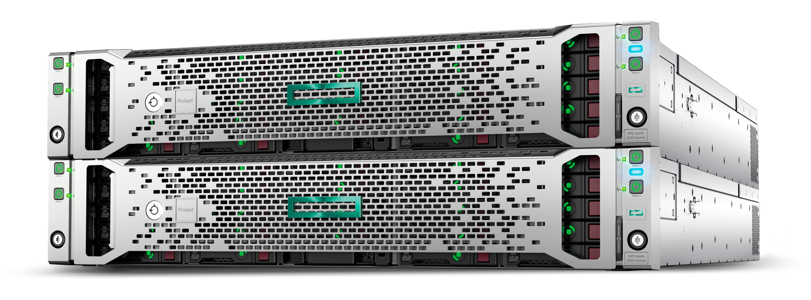

.. include:: ../README.rst

Documentation for the PROSPERO HPC facility
===========================================================

Prospero is the centralised high performance computing (HPC) facility for research at `Liverpool John Moores University <https://ljmu.ac.uk/>`_. The facility was commissioned in August 2020, is hosted and administered by LJMU's `IT services division <https://www.ljmu.ac.uk/itservices>`_.

Prospero is available for use by all research staff and postgraduate research students at LJMU, subject to usage `policies <https://prospero-docs.readthedocs.io/en/latest/policies.html>`_. To start using Prospero please see `Getting Access <https://prospero-docs.readthedocs.io/en/latest/access.html>`_.

.. IMPORTANT::

   13/11/2026 - The migration of Prospero to the RHEL v9.7 operating system is now complete. Access to the system is now only possible through login3. It is important to recognise that Prospero is now a heterogeneous facility, with the SLURM cpu partitions including nodes with two different specifications: this has **important implications** for how job submission scripts should be written, please see `here <https://prospero-docs.readthedocs.io/en/latest/scheduler.html#slurm-scripts-in-the-prospero-ii-era>`_. For further infomation about the new O/S please see `here <https://prospero-docs.readthedocs.io/en/latest/access.html#migrating-to-the-new-operating-system>`_.

.. NOTE::

   Prospero uses the Linux operating system and does not run software designed for Windows

Contents
--------

.. toctree::
  :maxdepth: 1
  :caption: ABOUT HPC at LJMU

  Home <self>
  specifications
  storage

    
.. toctree::
  :maxdepth: 1
  :caption: GETTING STARTED

  access

.. toctree::
  :maxdepth: 2
  :caption: RUNNING JOBS

  scheduler

.. toctree::
  :maxdepth: 3
  :caption: SOFTWARE

  software

.. toctree::
  :maxdepth: 4
  :caption: GETTING HELP
  
  help
  policies

.. toctree::
  :maxdepth: 5
  :caption: ADDITIONAL RESOURCES

  highlights
  history
  vnc
  environmental
